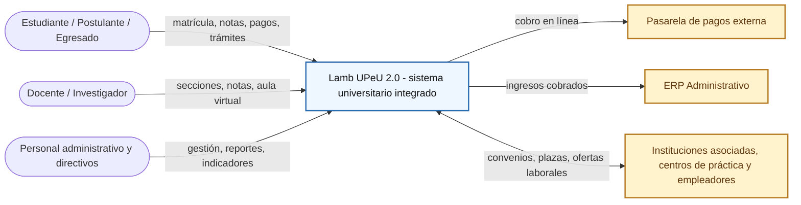
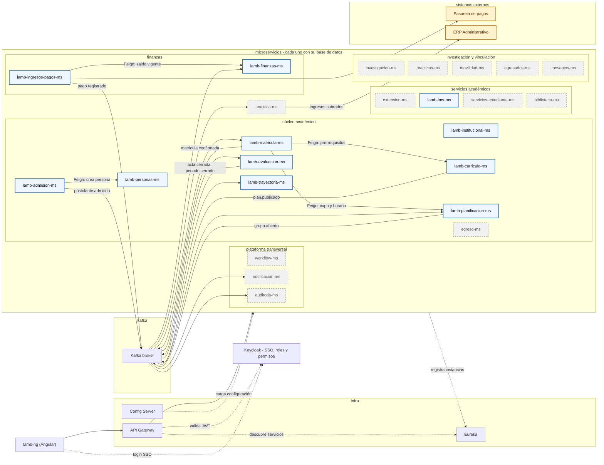

# Lamb UPeU 2.0 {#lamb-upeu-20}

Plataforma integrada de gestión académica y administrativa para la universidad: desde la admisión y la matrícula hasta la evaluación, las finanzas del estudiante, el egreso y el seguimiento de egresados, con servicios transversales de identidad, flujos, notificaciones y auditoría.

El sistema se organiza en **22 módulos funcionales** y **94 historias de usuario**, y se implementa como un conjunto de microservicios coordinados por un punto único de acceso.

<div class="grid cards" markdown>

- :material-view-module: **22** módulos funcionales

- :material-account-details: **94** historias de usuario

- :material-account-group: **22** roles identificados

- :material-server-network: **24** microservicios de dominio

</div>

## Producto del curso

```
Sistema universitario integrado de microservicios end-to-end: configurable,
seguro, consistente, observable, con inicio de sesión único (SSO) y operable
por estudiantes, docentes, postulantes, egresados y personal administrativo.
```

Resultado esperado:

Cada módulo del sistema queda respaldado por historias de usuario con criterios de aceptación verificables, asignado a un microservicio con responsabilidad y datos propios, y conectado con los demás mediante el Gateway, llamadas síncronas puntuales y eventos asíncronos.

## Contenido

### 1. Historias de usuario

Resumen del alcance funcional: 22 módulos, 94 historias.

| Módulo | Nombre | Historias | Rango |
|--------|--------|-----------|-------|
| 1 | [Institucional y Organización](#m1) | 4 | HU 001–004 |
| 2 | [Personas](#m2) | 4 | HU 005–008 |
| 3 | [Admisión e Ingreso](#m3) | 5 | HU 009–013 |
| 4 | [Currículo](#m4) | 5 | HU 014–018 |
| 5 | [Planificación y Oferta Académica](#m5) | 6 | HU 019–024 |
| 6 | [Matrícula](#m6) | 6 | HU 025–030 |
| 7 | [Evaluación y Cierre Académico](#m7) | 5 | HU 031–035 |
| 8 | [Trayectoria Académica](#m8) | 4 | HU 036–039 |
| 9 | [Finanzas del Estudiante](#m9) | 5 | HU 040–044 |
| 10 | [Egreso, Grados, Títulos y Certificación](#m10) | 4 | HU 045–048 |
| 11 | [Ingresos, Cobranza y Pagos](#m11) | 5 | HU 049–053 |
| 12 | [Extensión, Educación Continua y Eventos](#m12) | 4 | HU 054–057 |
| 13 | [LMS / Aprendizaje](#m13) | 5 | HU 058–062 |
| 14 | [Servicios al Estudiante](#m14) | 4 | HU 063–066 |
| 15 | [Investigación](#m15) | 4 | HU 067–070 |
| 16 | [Prácticas, Internado y Vinculación](#m16) | 4 | HU 071–074 |
| 17 | [Movilidad e Internacionalización](#m17) | 3 | HU 075–077 |
| 18 | [Egresados y Seguimiento](#m18) | 3 | HU 078–080 |
| 19 | [Convenios y Relaciones Institucionales](#m19) | 3 | HU 081–083 |
| 20 | [Biblioteca y Recursos Académicos](#m20) | 4 | HU 084–087 |
| 21 | [Analítica, Indicadores y BI](#m21) | 3 | HU 088–090 |
| 22 | [Plataforma Transversal](#m22) | 4 | HU 091–094 |

#### 1. Institucional y Organización {#m1}

*Institución, campus, sedes, facultades, escuelas, programas, periodos y calendarios*

| HU | Como | Quiero | Para | Criterios de aceptación |
|----|------|--------|------|-------------------------|
| 001 | Administrador | registrar la institución con sus sedes y campus | tener la estructura organizacional base del sistema | • Cada sede se registra con nombre, dirección y campus asociados.<br>• No se puede eliminar una sede con facultades activas.<br>• La estructura registrada queda disponible para el resto de módulos. |
| 002 | Administrador | crear facultades y escuelas dentro de cada sede | organizar los programas académicos por unidad | • Cada escuela pertenece obligatoriamente a una facultad.<br>• Se puede editar el nombre y el responsable de cada unidad.<br>• Las escuelas creadas aparecen disponibles al registrar programas. |
| 003 | Administrador | definir los periodos académicos y su calendario | que el resto del sistema use las mismas fechas de referencia | • Cada periodo define fecha de inicio, fin y fechas clave (matrícula, retiros, cierre).<br>• No se pueden crear dos periodos con fechas superpuestas.<br>• Los módulos de matrícula y evaluación toman las fechas de este calendario. |
| 004 | Administrador | configurar los programas académicos ofrecidos por cada escuela | que estén disponibles al crear planes de estudio | • Cada programa se asocia a una sola escuela.<br>• Se registra el grado o título que otorga el programa.<br>• Un programa sin planes de estudio no puede activarse para admisión. |

#### 2. Personas {#m2}

*Persona, identificación, datos personales, contactos y documentos*

| HU | Como | Quiero | Para | Criterios de aceptación |
|----|------|--------|------|-------------------------|
| 005 | Administrador | registrar a una persona con su identificación y datos personales | tener una única fuente de verdad de identidad en el sistema | • El documento de identidad es único: no se permiten registros duplicados.<br>• Una misma persona puede tener varios roles (estudiante, docente, etc.).<br>• El registro queda disponible para todos los módulos que la referencien. |
| 006 | Estudiante | actualizar mis datos de contacto (correo, teléfono, dirección) | que la institución tenga información vigente para comunicarse conmigo | • Puedo editar mis datos de contacto desde mi perfil en cualquier momento.<br>• El sistema valida el formato del correo y el teléfono.<br>• Las notificaciones futuras usan automáticamente los datos actualizados. |
| 007 | Estudiante | subir mis documentos de identidad y estudios previos | completar mi expediente personal | • Se aceptan archivos PDF o imagen hasta un tamaño máximo definido.<br>• Cada documento queda marcado como pendiente o verificado.<br>• Puedo reemplazar un documento mientras no haya sido verificado. |
| 008 | Administrador | buscar una persona por documento de identidad o nombre | ubicar rápidamente su información en cualquier trámite | • La búsqueda funciona por coincidencia parcial de nombre o documento exacto.<br>• Los resultados muestran los roles activos de la persona.<br>• Solo usuarios autorizados pueden ver los documentos adjuntos. |

#### 3. Admisión e Ingreso {#m3}

*Prospectos, postulantes, evaluaciones, resultados e ingreso*

| HU | Como | Quiero | Para | Criterios de aceptación |
|----|------|--------|------|-------------------------|
| 009 | Prospecto | inscribirme como postulante indicando el programa al que aspiro | participar en el proceso de admisión | • El formulario pide datos personales, programa de interés y documentos requeridos.<br>• Al enviarlo recibo una constancia de postulación.<br>• Solo puedo postular a programas con proceso de admisión abierto. |
| 010 | Postulante | rendir el examen de admisión en línea | completar el proceso de evaluación | • El examen solo está disponible dentro de la fecha y hora programadas.<br>• El sistema controla el tiempo restante y envía automáticamente al finalizar.<br>• Una vez enviado no se puede volver a rendir el mismo examen. |
| 011 | Postulante | consultar el resultado de mi evaluación de admisión | saber si fui admitido | • El resultado solo es visible después de la publicación oficial.<br>• Se muestra el puntaje obtenido y el estado (admitido / no admitido).<br>• Recibo una notificación en cuanto el resultado está disponible. |
| 012 | Administrador De Admisión | publicar los resultados del examen de admisión | que los postulantes conozcan su situación | • La publicación se hace en bloque para todo un proceso de admisión.<br>• Antes de publicar puedo revisar la lista de resultados como borrador.<br>• Una vez publicado, el resultado no puede modificarse sin registrar el motivo. |
| 013 | Administrador De Admisión | registrar el ingreso de un postulante admitido al núcleo académico | que quede habilitado como estudiante y pueda matricularse | • Solo se puede registrar el ingreso de postulantes marcados como admitidos.<br>• El sistema crea automáticamente el registro de persona/estudiante si no existe.<br>• El estudiante ingresado queda habilitado para matricularse en el periodo correspondiente. |

#### 4. Currículo {#m4}

*Programas, planes, versiones, asignaturas, créditos, requisitos y equivalencias*

| HU | Como | Quiero | Para | Criterios de aceptación |
|----|------|--------|------|-------------------------|
| 014 | Coordinador Académico | crear un plan de estudios con sus asignaturas y créditos | definir la malla curricular de un programa | • Cada asignatura registra sus créditos y el ciclo en que se dicta.<br>• La suma de créditos del plan se calcula automáticamente.<br>• Un plan sin asignaturas no puede publicarse como vigente. |
| 015 | Coordinador Académico | crear una nueva versión de un plan de estudios | actualizar la malla sin afectar a los estudiantes de versiones anteriores | • Cada estudiante queda vinculado a la versión del plan vigente al momento de su ingreso.<br>• La nueva versión puede copiar asignaturas de la versión anterior como base.<br>• Las versiones anteriores quedan archivadas pero consultables. |
| 016 | Coordinador Académico | definir los prerrequisitos entre asignaturas | que el sistema controle el orden en que se pueden llevar | • No se permite guardar un requisito que forme un ciclo entre asignaturas.<br>• El sistema impide inscribir una asignatura sin el prerrequisito aprobado.<br>• Se puede consultar el árbol de prerrequisitos de cualquier asignatura. |
| 017 | Coordinador Académico | registrar equivalencias entre asignaturas de distintos planes | que un estudiante que cambia de plan no repita contenido ya aprobado | • Cada equivalencia registra la asignatura de origen y la de destino.<br>• Al aplicarse una equivalencia, la nota original se traslada al nuevo plan.<br>• Queda un registro de qué equivalencia originó cada traslado de nota. |
| 018 | Estudiante | consultar mi malla curricular con el estado de cada asignatura | saber qué me falta para egresar | • Cada asignatura se marca como aprobada, en curso, pendiente o bloqueada.<br>• Las asignaturas bloqueadas indican qué prerrequisito falta.<br>• La malla se organiza visualmente por ciclo. |

#### 5. Planificación y Oferta Académica {#m5}

*Cursos, secciones, docentes, horarios, aulas, cupos, modalidad y carga docente*

| HU | Como | Quiero | Para | Criterios de aceptación |
|----|------|--------|------|-------------------------|
| 019 | Coordinador Académico | abrir secciones de un curso para un periodo académico | ofrecer la asignatura a los estudiantes | • Cada sección se asocia a una asignatura y un periodo específico.<br>• Se define la modalidad de la sección: presencial, virtual o híbrida.<br>• Una sección sin docente ni horario no puede publicarse en el catálogo. |
| 020 | Coordinador Académico | asignar un docente y un aula a cada sección | dejar la oferta lista antes de matrícula | • El sistema advierte si el docente ya tiene otra sección en el mismo horario.<br>• El aula asignada debe tener capacidad igual o mayor al cupo de la sección.<br>• Se puede reasignar docente o aula mientras la sección no tenga matriculados. |
| 021 | Coordinador Académico | definir el horario de cada sección evitando cruces de aula | que no se solapen dos secciones en el mismo espacio | • El sistema rechaza un horario si el aula ya está ocupada en ese bloque.<br>• Se pueden definir varios bloques horarios para una misma sección.<br>• El horario final queda visible en el catálogo de oferta. |
| 022 | Coordinador Académico | establecer el cupo máximo de cada sección | controlar cuántos estudiantes pueden inscribirse | • La matrícula rechaza inscripciones una vez alcanzado el cupo.<br>• Se puede ampliar el cupo de una sección mientras existan vacantes de aula.<br>• El cupo disponible se actualiza en tiempo real al matricular o retirar estudiantes. |
| 023 | Docente | consultar mi carga docente del periodo con mis secciones asignadas | conocer mi horario de clases | • Se muestra el curso, aula y horario de cada sección asignada.<br>• Se muestra el número de estudiantes matriculados por sección.<br>• La información se actualiza si el coordinador modifica alguna sección. |
| 024 | Estudiante | consultar el catálogo de secciones disponibles de un periodo | elegir en qué inscribirme | • El catálogo muestra docente, horario, modalidad y vacantes disponibles.<br>• Se puede filtrar por asignatura, ciclo o modalidad.<br>• Las secciones sin cupo se muestran marcadas como llenas. |

#### 6. Matrícula {#m6}

*Inscripción, retiros, cambios, reservas, reglas y bloqueos*

| HU | Como | Quiero | Para | Criterios de aceptación |
|----|------|--------|------|-------------------------|
| 025 | Estudiante | inscribirme en las secciones de los cursos que voy a llevar | formalizar mi matrícula del periodo | • El sistema valida prerrequisitos, cupo y cruces de horario antes de confirmar.<br>• Se muestra un costo estimado antes de enviar la matrícula.<br>• Al confirmar, se genera el cargo correspondiente en Finanzas del Estudiante. |
| 026 | Estudiante | elegir el número de cuotas para el pago de mi matrícula | distribuir el costo en varios meses | • El número de cuotas solo puede elegirse dentro del rango permitido por la institución.<br>• Cada cuota elegida genera un cargo de enseñanza programado para su mes.<br>• El estudiante puede ver el detalle de cuotas antes de confirmar la matrícula. |
| 027 | Estudiante | retirarme de una sección antes de la fecha límite | dejar de cursar una asignatura sin que afecte mi historial | • El retiro solo está permitido dentro del plazo definido en el calendario del periodo.<br>• La sección liberada aumenta el cupo disponible para otros estudiantes.<br>• El curso retirado se marca como "retirado", no como reprobado. |
| 028 | Estudiante | cambiar de sección de un curso en el periodo de reprogramación | ajustar mi horario | • El cambio solo procede si la nueva sección tiene cupo disponible.<br>• El sistema valida que no se generen cruces de horario con mis otros cursos.<br>• El cambio no genera un cargo adicional si es la misma asignatura. |
| 029 | Estudiante | reservar mi matrícula para no perder mi vacante en el programa | conservar mi lugar sin inscribir cursos ese periodo | • La reserva tiene un número máximo de periodos consecutivos permitidos.<br>• Un estudiante con reserva no genera cargos de matrícula ese periodo.<br>• Al vencer el plazo de reserva, el sistema alerta que debe matricularse o perderá la vacante. |
| 030 | Administrador | bloquear la matrícula de un estudiante con deuda o trámite pendiente | impedir que se inscriba hasta que regularice su situación | • El bloqueo indica el motivo (financiero, documentario, disciplinario, etc.).<br>• Un estudiante bloqueado no puede completar el proceso de matrícula.<br>• El bloqueo se libera automáticamente al resolverse el motivo o manualmente por un administrador. |

#### 7. Evaluación y Cierre Académico {#m7}

*Evaluaciones, notas, actas, rectificaciones y cierre*

| HU | Como | Quiero | Para | Criterios de aceptación |
|----|------|--------|------|-------------------------|
| 031 | Docente | registrar las notas de mis estudiantes en cada evaluación | llevar el control de su desempeño | • Solo puedo registrar notas de estudiantes matriculados en mi sección.<br>• El sistema valida que la nota esté dentro de la escala permitida.<br>• Puedo editar una nota mientras el acta de la sección no esté cerrada. |
| 032 | Estudiante | consultar mis notas de cada curso durante el periodo | hacer seguimiento a mi rendimiento | • Se muestran las notas registradas por evaluación y el promedio parcial del curso.<br>• Las notas se actualizan apenas el docente las registra.<br>• Puedo ver el detalle de cada evaluación (nombre, fecha, peso). |
| 033 | Docente | cerrar el acta final de notas de mi sección | formalizar los resultados del periodo | • El acta solo se puede cerrar si todos los estudiantes tienen nota final registrada.<br>• Una vez cerrada el acta, las notas dejan de ser editables directamente.<br>• El cierre del acta actualiza automáticamente la trayectoria académica del estudiante. |
| 034 | Coordinador Académico | aprobar una rectificación de nota solicitada por un docente | corregir un error después del cierre del acta | • La solicitud debe incluir la nota anterior, la nueva y el motivo del cambio.<br>• Solo un coordinador puede aprobar o rechazar la rectificación.<br>• Toda rectificación aprobada queda registrada en el historial de auditoría. |
| 035 | Administrador | cerrar académicamente el periodo una vez cerradas todas las actas | habilitar el cálculo de trayectoria y avance | • El sistema impide el cierre si existen actas de secciones aún pendientes.<br>• Al cerrar el periodo se recalcula el promedio y el avance de créditos de cada estudiante.<br>• Después del cierre, cualquier corrección requiere una rectificación formal. |

#### 8. Trayectoria Académica {#m8}

*Historial, promedio, créditos, avance, convalidaciones y reconocimientos*

| HU | Como | Quiero | Para | Criterios de aceptación |
|----|------|--------|------|-------------------------|
| 036 | Estudiante | consultar mi historial académico completo | ver todos los cursos que he llevado y sus notas | • El historial se organiza por periodo académico.<br>• Se distinguen los cursos aprobados, desaprobados, retirados y convalidados.<br>• El historial se deriva de matrícula, evaluación y convalidaciones, no se edita directamente. |
| 037 | Estudiante | ver mi promedio ponderado y mi avance de créditos | saber cuánto me falta para culminar el programa | • El promedio se recalcula automáticamente al cerrarse cada periodo.<br>• Se muestra el porcentaje de créditos aprobados frente al total del plan.<br>• El avance refleja las equivalencias y convalidaciones ya aplicadas. |
| 038 | Estudiante | solicitar la convalidación de un curso llevado en otra institución | no repetirlo si ya lo aprobé antes | • La solicitud requiere adjuntar el certificado y el sílabo del curso externo.<br>• Puedo hacer seguimiento del estado de mi solicitud (en revisión, aprobada, rechazada).<br>• Si se aprueba, el curso queda reflejado en mi trayectoria como convalidado. |
| 039 | Coordinador Académico | evaluar y aprobar o rechazar una solicitud de convalidación | decidir si el curso externo es equivalente | • Puedo comparar el sílabo del curso externo con la asignatura del plan.<br>• Toda decisión requiere un sustento o comentario registrado.<br>• El estudiante recibe una notificación con el resultado de su solicitud. |

#### 9. Finanzas del Estudiante {#m9}

*Matrícula, enseñanza, derechos académicos, becas y descuentos*

| HU | Como | Quiero | Para | Criterios de aceptación |
|----|------|--------|------|-------------------------|
| 040 | Estudiante | ver el cargo de matrícula generado tras inscribir mis cursos | saber cuánto debo pagar y cuándo | • El monto se calcula con el costo real de cada curso, no el estimado de matrícula.<br>• El cargo muestra el concepto (matrícula) y la unidad organizacional del programa.<br>• El cargo queda disponible para pago desde el momento en que se confirma la matrícula. |
| 041 | Estudiante | ver el calendario de cargos de enseñanza de las cuotas siguientes | planificar mis pagos mensuales | • Se muestra un cargo de enseñanza por cada cuota elegida en matrícula, con su fecha.<br>• Los cargos futuros aparecen como programados, no cobrables aún.<br>• Un cargo se habilita para pago automáticamente al llegar su fecha. |
| 042 | Administrador De Finanzas | aplicar un descuento o beca a un estudiante | reflejar el beneficio en sus cargos | • El descuento puede ser un porcentaje o un monto fijo, con vigencia definida.<br>• El beneficio se aplica automáticamente a los cargos generados mientras esté vigente.<br>• Se registra el motivo y el responsable que autorizó el beneficio. |
| 043 | Administrador De Finanzas | configurar el tarifario por crédito y programa antes de cada periodo | que los cargos se calculen con el costo correcto | • El tarifario se define por programa y puede variar entre periodos.<br>• No se pueden generar cargos de un periodo sin tarifario configurado.<br>• Un cambio de tarifario no afecta cargos ya generados en periodos anteriores. |
| 044 | Estudiante | ver el saldo pendiente de cada uno de mis cargos | saber cuánto me falta pagar | • El saldo se actualiza automáticamente con cada pago registrado, en línea o en caja.<br>• La suma de pagos de un cargo nunca puede superar su monto total.<br>• Se distingue claramente entre cargos ya cancelados y con saldo pendiente. |

#### 10. Egreso, Grados, Títulos y Certificación {#m10}

*Trámite de egreso, obtención de grados, títulos y constancias*

| HU | Como | Quiero | Para | Criterios de aceptación |
|----|------|--------|------|-------------------------|
| 045 | Estudiante | solicitar mi trámite de egreso al completar el plan de estudios | iniciar el proceso de titulación | • La solicitud solo se habilita si mi avance de créditos llega al 100% del plan.<br>• Puedo ver el estado de mi trámite en cada etapa del proceso.<br>• Se me informa si tengo algún requisito pendiente (deuda, documento, etc.). |
| 046 | Administrador Académico | verificar que un estudiante cumple los requisitos de egreso | aprobar o rechazar la solicitud | • El sistema muestra un checklist con créditos, deuda y documentos pendientes.<br>• Solo puedo aprobar el egreso si todos los requisitos están completos.<br>• Un rechazo requiere indicar el motivo para que el estudiante lo subsane. |
| 047 | Estudiante | solicitar mi título profesional o grado académico | obtener el documento oficial | • La solicitud solo procede si mi trámite de egreso ya fue aprobado.<br>• Puedo elegir la modalidad de titulación disponible para mi programa.<br>• Recibo una notificación cuando el título esté listo para recoger o descargar. |
| 048 | Egresado | descargar mi certificado de estudios o constancia | presentarlo ante terceros | • El documento se genera con un código de verificación único.<br>• Puedo descargarlo en PDF desde mi cuenta en cualquier momento.<br>• Un tercero puede validar su autenticidad ingresando el código de verificación. |

#### 11. Ingresos, Cobranza y Pagos {#m11}

*Cargos, cuentas por cobrar, caja, pagos, pasarelas y comprobantes*

| HU | Como | Quiero | Para | Criterios de aceptación |
|----|------|--------|------|-------------------------|
| 049 | Estudiante | pagar un cargo pendiente a través de una pasarela en línea | cancelar mi deuda sin acercarme a caja | • Antes de cobrar, el sistema verifica el saldo vigente del cargo con Finanzas del Estudiante.<br>• Al confirmarse el pago en la pasarela, el saldo se actualiza automáticamente.<br>• Si el pago falla o se cancela, el cargo permanece con su saldo original. |
| 050 | Cajero | registrar el pago presencial de un estudiante en ventanilla | actualizar su saldo al instante | • Puedo buscar los cargos pendientes de un estudiante por su documento de identidad.<br>• El sistema no permite registrar un pago mayor al saldo pendiente del cargo.<br>• El pago queda reflejado de inmediato en el saldo consultado por el estudiante. |
| 051 | Estudiante | combinar un pago parcial en línea y el resto en caja | cubrir un cargo usando ambos canales | • Cada canal descuenta del mismo saldo compartido del cargo, sin duplicar el cobro.<br>• El cargo se marca como cancelado solo cuando la suma de ambos pagos llega al total.<br>• Puedo ver el detalle de qué monto se pagó por cada canal. |
| 052 | Cajero | emitir el comprobante de pago de una transacción | entregar constancia al estudiante | • El comprobante incluye monto, concepto, fecha y medio de pago.<br>• Cada comprobante tiene un número correlativo único.<br>• El comprobante puede reimprimirse o reenviarse por correo posteriormente. |
| 053 | Administrador De Finanzas | procesar la devolución de un pago realizado en exceso | regularizar la cuenta del estudiante | • La devolución no puede superar el monto efectivamente pagado en exceso.<br>• Se registra el motivo y el medio por el que se realiza la devolución.<br>• El saldo del estudiante se actualiza una vez procesada la devolución. |

#### 12. Extensión, Educación Continua y Eventos {#m12}

*Talleres, diplomados, seminarios, congresos e inscripciones*

| HU | Como | Quiero | Para | Criterios de aceptación |
|----|------|--------|------|-------------------------|
| 054 | Participante | inscribirme en un taller, diplomado o curso libre | participar en la actividad de extensión | • La inscripción solo se habilita si el evento tiene cupo disponible.<br>• Si el evento tiene costo, la inscripción queda ligada a su cargo de pago.<br>• Recibo una confirmación de inscripción con los datos del evento. |
| 055 | Coordinador De Extensión | publicar un nuevo evento o programa de educación continua | abrir sus inscripciones al público | • El evento define fechas, cupo máximo y costo (si aplica).<br>• Un evento sin fechas definidas no puede publicarse.<br>• El evento publicado queda visible en el catálogo de extensión. |
| 056 | Coordinador De Extensión | registrar la asistencia de los participantes de un evento | llevar el control de quienes completaron la actividad | • La asistencia se registra por sesión cuando el evento tiene varias fechas.<br>• Solo los participantes con asistencia mínima requerida son elegibles para certificado.<br>• Se puede exportar la lista de asistencia del evento. |
| 057 | Participante | descargar mi certificado de participación al finalizar el curso | acreditar mi asistencia | • El certificado solo se genera si cumplí el porcentaje de asistencia requerido.<br>• El documento incluye el nombre del evento, fechas y horas certificadas.<br>• Puedo descargarlo en PDF desde mi cuenta. |

#### 13. LMS / Aprendizaje {#m13}

*Contenidos, tareas, foros, evaluaciones, recursos y seguimiento*

| HU | Como | Quiero | Para | Criterios de aceptación |
|----|------|--------|------|-------------------------|
| 058 | Docente | publicar contenidos y recursos de mi curso en el aula virtual | que mis estudiantes accedan al material | • Puedo organizar los contenidos por unidad o semana.<br>• Solo los estudiantes matriculados en la sección pueden ver el material.<br>• Puedo programar la fecha de publicación de cada contenido. |
| 059 | Estudiante | entregar una tarea asignada dentro del plazo establecido | cumplir con las actividades del curso | • El sistema bloquea la entrega automáticamente al vencer el plazo.<br>• Puedo ver el estado de mi entrega (pendiente, entregada, calificada).<br>• Puedo reemplazar mi entrega mientras el plazo no haya vencido. |
| 060 | Estudiante | participar en el foro de discusión de mi curso | resolver dudas e interactuar con compañeros y docente | • Puedo crear un nuevo tema o responder a uno existente.<br>• Los mensajes muestran el nombre del autor y la fecha de publicación.<br>• El docente puede fijar o cerrar un tema del foro. |
| 061 | Docente | crear una evaluación en línea con calificación automática | agilizar la revisión de mis estudiantes | • Las preguntas de opción única o múltiple se califican automáticamente al enviar.<br>• Puedo definir tiempo límite y número de intentos permitidos.<br>• El resultado se refleja automáticamente en el registro de notas del curso. |
| 062 | Docente | hacer seguimiento del progreso de mis estudiantes en el curso | identificar a quienes necesitan apoyo adicional | • Se muestra el porcentaje de avance de cada estudiante en el contenido del curso.<br>• Se resaltan los estudiantes con tareas no entregadas o notas bajas.<br>• Puedo exportar el reporte de seguimiento del curso. |

#### 14. Servicios al Estudiante {#m14}

*Tutoría, asesoría académica, bienestar, trámites, solicitudes y reclamos*

| HU | Como | Quiero | Para | Criterios de aceptación |
|----|------|--------|------|-------------------------|
| 063 | Estudiante | solicitar una cita de tutoría o asesoría académica | recibir orientación sobre mi desempeño | • Puedo elegir entre los horarios disponibles del tutor o asesor.<br>• Recibo una confirmación con fecha, hora y modalidad de la cita.<br>• Puedo cancelar la cita con una anticipación mínima definida. |
| 064 | Estudiante | registrar un trámite o solicitud administrativa | pedir un servicio de la universidad | • Puedo elegir el tipo de trámite de una lista predefinida.<br>• El sistema me muestra el tiempo estimado de atención de cada tipo de trámite.<br>• Puedo hacer seguimiento del estado de mi trámite hasta su resolución. |
| 065 | Estudiante | presentar un reclamo formal sobre un servicio recibido | que sea atendido por la instancia correspondiente | • El reclamo se enruta automáticamente al área responsable según su categoría.<br>• Recibo un número de seguimiento al registrar el reclamo.<br>• Se me notifica cuando el reclamo cambia de estado o recibe respuesta. |
| 066 | Asesor | dar seguimiento a los casos de acompañamiento de mis estudiantes asignados | monitorear su bienestar y avance | • Puedo registrar notas de seguimiento en cada caso.<br>• Los casos se pueden marcar como abiertos, en seguimiento o cerrados.<br>• Solo tengo acceso a los casos de los estudiantes asignados a mí. |

#### 15. Investigación {#m15}

*Proyectos, grupos, investigadores, semilleros, producción científica y repositorio*

| HU | Como | Quiero | Para | Criterios de aceptación |
|----|------|--------|------|-------------------------|
| 067 | Investigador | registrar un nuevo proyecto de investigación con su grupo | formalizar el inicio de sus actividades | • El proyecto registra investigador principal, colaboradores y fechas de ejecución.<br>• Puedo asociar el proyecto a una línea de investigación institucional.<br>• El proyecto queda visible en el listado de proyectos activos de la institución. |
| 068 | Estudiante | unirme a un semillero de investigación | participar en actividades científicas dentro de mi programa | • Puedo ver los semilleros activos y su línea temática antes de postular.<br>• La incorporación requiere aprobación del investigador responsable del semillero.<br>• Una vez aceptado, aparezco listado como miembro activo del semillero. |
| 069 | Investigador | publicar la producción científica derivada de mi proyecto | que quede disponible en el repositorio institucional | • Puedo adjuntar el documento junto con autores, resumen y palabras clave.<br>• La publicación queda vinculada al proyecto de investigación de origen.<br>• El repositorio permite buscar la producción por autor, año o línea de investigación. |
| 070 | Investigador | inscribir mi trabajo en una jornada de investigación | presentarlo ante la comunidad académica | • La inscripción solo se habilita mientras la jornada tenga convocatoria abierta.<br>• Debo indicar el título, resumen y modalidad de presentación del trabajo.<br>• Recibo confirmación con la fecha y sesión asignada para mi presentación. |

#### 16. Prácticas, Internado y Vinculación {#m16}

*Prácticas preprofesionales, internado, centros de práctica y convenios*

| HU | Como | Quiero | Para | Criterios de aceptación |
|----|------|--------|------|-------------------------|
| 071 | Estudiante | postular a una plaza de práctica preprofesional o internado | iniciar mi proceso de prácticas | • Solo puedo postular si cumplo el avance de créditos mínimo requerido.<br>• Puedo ver las plazas disponibles por centro de práctica y área.<br>• Recibo notificación cuando el centro de práctica acepta o rechaza mi postulación. |
| 072 | Supervisor De Prácticas | registrar la evaluación de un estudiante en su centro de práctica | calificar su desempeño | • La evaluación usa una rúbrica con criterios definidos por la universidad.<br>• Solo puedo evaluar a los estudiantes que tengo asignados como supervisor.<br>• La calificación registrada se refleja en el expediente de prácticas del estudiante. |
| 073 | Estudiante | subir las evidencias de mis actividades de práctica | sustentar el cumplimiento de mis horas | • Cada evidencia se asocia a una fecha y a un número de horas realizadas.<br>• El sistema acumula automáticamente el total de horas registradas.<br>• Mi supervisor puede revisar y validar cada evidencia subida. |
| 074 | Coordinador De Prácticas | gestionar los convenios con los centros de práctica disponibles | ofrecer plazas vigentes a los estudiantes | • Cada convenio registra vigencia, responsable y número de plazas ofrecidas.<br>• Un centro con convenio vencido no puede publicar nuevas plazas.<br>• Recibo una alerta cuando un convenio esté próximo a vencer. |

#### 17. Movilidad e Internacionalización {#m17}

*Intercambio, movilidad entrante/saliente, estancias y reconocimiento académico*

| HU | Como | Quiero | Para | Criterios de aceptación |
|----|------|--------|------|-------------------------|
| 075 | Estudiante | postular a un programa de movilidad o intercambio | realizar una estancia académica en otra institución | • Solo puedo postular a convenios de movilidad vigentes con mi universidad.<br>• Debo indicar el periodo de destino y los cursos que planeo llevar allá.<br>• Recibo notificación del resultado de mi postulación en el plazo definido. |
| 076 | Coordinador De Movilidad | registrar la llegada de un estudiante de movilidad entrante | incorporarlo temporalmente a un programa | • El registro crea un perfil temporal vinculado a la institución de origen.<br>• El estudiante entrante queda habilitado solo para las secciones autorizadas.<br>• Al finalizar su estancia, el acceso se desactiva automáticamente. |
| 077 | Estudiante | solicitar el reconocimiento académico de los cursos llevados durante mi movilidad | que se incorporen a mi trayectoria | • Debo adjuntar el certificado de notas emitido por la institución de destino.<br>• La solicitud sigue el mismo flujo de revisión que una convalidación.<br>• Los cursos reconocidos se reflejan en mi historial académico como tal. |

#### 18. Egresados y Seguimiento {#m18}

*Empleabilidad, bolsa de trabajo, seguimiento laboral y alumni*

| HU | Como | Quiero | Para | Criterios de aceptación |
|----|------|--------|------|-------------------------|
| 078 | Egresado | actualizar mi situación laboral en el sistema de seguimiento | que la universidad conozca mi trayectoria profesional | • Puedo indicar si estoy empleado, buscando empleo o estudiando.<br>• Puedo actualizar mi información laboral cuando lo necesite.<br>• El sistema guarda un historial de mis actualizaciones anteriores. |
| 079 | Egresado | postular a una oferta publicada en la bolsa de trabajo | acceder a oportunidades laborales | • Puedo filtrar ofertas por carrera, ubicación o modalidad de trabajo.<br>• Al postular, mi hoja de vida se envía automáticamente al empleador registrado.<br>• Puedo ver el estado de mis postulaciones enviadas. |
| 080 | Administrador | publicar indicadores de empleabilidad de los egresados de un programa | reportarlos ante entidades de acreditación | • El indicador se calcula a partir de la información de seguimiento reportada por los egresados.<br>• Se puede filtrar el indicador por programa, cohorte y periodo.<br>• El reporte puede exportarse en un formato apto para entidades externas. |

#### 19. Convenios y Relaciones Institucionales {#m19}

*Instituciones asociadas, convenios marco y específicos, vigencia y beneficios*

| HU | Como | Quiero | Para | Criterios de aceptación |
|----|------|--------|------|-------------------------|
| 081 | Administrador De Convenios | registrar un convenio marco con una institución asociada | formalizar la relación institucional | • El convenio registra institución asociada, responsables y periodo de vigencia.<br>• No se puede registrar un convenio marco duplicado con la misma institución vigente.<br>• El convenio queda disponible como base para registrar convenios específicos. |
| 082 | Administrador De Convenios | registrar un convenio específico bajo un convenio marco vigente | detallar compromisos y beneficios concretos | • Solo se puede crear un convenio específico si su convenio marco está vigente.<br>• Se registran los compromisos y beneficios propios de ese convenio específico.<br>• La vigencia del convenio específico no puede exceder la del convenio marco. |
| 083 | Administrador De Convenios | recibir una alerta cuando un convenio esté por vencer | gestionar su renovación a tiempo | • La alerta se genera con una anticipación configurable antes del vencimiento.<br>• Se muestra un listado de convenios próximos a vencer ordenado por fecha.<br>• Un convenio vencido queda marcado y deja de habilitar nuevas actividades asociadas. |

#### 20. Biblioteca y Recursos Académicos {#m20}

*Catálogo, préstamos, recursos digitales y bases de datos*

| HU | Como | Quiero | Para | Criterios de aceptación |
|----|------|--------|------|-------------------------|
| 084 | Estudiante | buscar un libro o recurso disponible en el catálogo de la biblioteca | ubicar material de estudio | • Puedo buscar por título, autor o tema.<br>• Los resultados muestran la disponibilidad de ejemplares físicos.<br>• Puedo filtrar los resultados por tipo de recurso (físico o digital). |
| 085 | Estudiante | solicitar el préstamo de un libro físico | llevarlo en calidad de préstamo | • El préstamo solo se habilita si hay un ejemplar disponible.<br>• El sistema indica la fecha límite de devolución al confirmar el préstamo.<br>• No puedo solicitar un nuevo préstamo si tengo devoluciones vencidas pendientes. |
| 086 | Bibliotecario | registrar la devolución de un libro prestado | actualizar la disponibilidad del ejemplar | • El ejemplar vuelve a quedar disponible inmediatamente tras la devolución.<br>• Si la devolución es tardía, el sistema calcula la penalidad correspondiente.<br>• Queda un registro histórico de cada préstamo y su devolución. |
| 087 | Estudiante | acceder a recursos digitales y bases de datos académicas | consultar bibliografía especializada en línea | • El acceso se valida automáticamente con mi sesión institucional, sin credenciales adicionales.<br>• Los recursos digitales están organizados por área temática.<br>• Solo puedo acceder a las bases de datos con licencia vigente para mi institución. |

#### 21. Analítica, Indicadores y BI {#m21}

*Dashboards, rendimiento, retención, deserción e indicadores institucionales*

| HU | Como | Quiero | Para | Criterios de aceptación |
|----|------|--------|------|-------------------------|
| 088 | Directivo | visualizar un dashboard con los indicadores de rendimiento y deserción | tomar decisiones basadas en datos | • El dashboard se puede filtrar por facultad, programa y periodo.<br>• Los indicadores se calculan a partir de los datos ya cerrados de cada periodo.<br>• Puedo exportar los indicadores mostrados en un archivo descargable. |
| 089 | Directivo | consultar la demanda de cursos y la carga docente por periodo | planificar la oferta académica siguiente | • Se muestra qué cursos tuvieron mayor demanda de matrícula frente a su cupo ofertado.<br>• Se muestra la carga docente promedio por facultad y por docente.<br>• Los datos se actualizan automáticamente al cerrarse cada periodo académico. |
| 090 | Directivo | consultar los indicadores de ingresos institucionales consolidados | monitorear la salud financiera de la universidad | • El indicador consolida los cargos cobrados de matrícula, enseñanza y otros conceptos.<br>• Se puede comparar el periodo actual contra periodos anteriores.<br>• El detalle contable de estos ingresos permanece a cargo del ERP Administrativo, no de este módulo. |

#### 22. Plataforma Transversal {#m22}

*Seguridad, roles, permisos, SSO, workflow, notificaciones y auditoría*

| HU | Como | Quiero | Para | Criterios de aceptación |
|----|------|--------|------|-------------------------|
| 091 | Usuario | iniciar sesión una sola vez y acceder a todos los módulos del sistema | no autenticarme repetidamente en cada módulo | • La autenticación se resuelve mediante un proveedor de identidad externo (SSO).<br>• Al cerrar sesión en un módulo, la sesión se cierra en todos los demás.<br>• Si mi sesión expira, se me redirige nuevamente al inicio de sesión único. |
| 092 | Administrador | configurar los roles y permisos de acceso por módulo | controlar qué puede hacer cada tipo de usuario | • Cada rol se compone de un conjunto de permisos específicos por módulo.<br>• Un usuario puede tener más de un rol asignado a la vez.<br>• Los cambios de permisos se aplican la próxima vez que el usuario ingresa al sistema. |
| 093 | Usuario | firmar digitalmente un documento dentro de un flujo de trabajo | formalizar una aprobación sin papel | • La firma queda vinculada a mi identidad y a la fecha y hora exactas del acto.<br>• Un documento firmado no puede modificarse sin invalidar la firma existente.<br>• El flujo avanza automáticamente al siguiente responsable una vez firmado. |
| 094 | Administrador | consultar el registro de auditoría de acciones realizadas en el sistema | investigar cambios o incidentes | • Cada registro de auditoría indica usuario, acción, módulo y fecha/hora.<br>• Puedo filtrar el registro por usuario, módulo o rango de fechas.<br>• Los registros de auditoría no pueden editarse ni eliminarse. |

### 2. Microservicios

Cada módulo funcional se materializa en un microservicio con su propia base de datos. El módulo 22 (Plataforma Transversal) se reparte entre Keycloak (SSO, roles y permisos) y tres servicios propios.

**Estado actual del código**: 11 microservicios implementados, 181 controllers REST analizados, de los cuales 137 son CRUD completo, 36 CRUD parcial (incluye los 13 controllers de institucional + personas con patrón `GET`/`GET {id}`/`POST`) y 8 son vistas de solo lectura o acciones de dominio sin persistencia HTTP.

#### Implementados

| # | Microservicio | Módulo | HU | Controllers | CRUD completo | Parciales | No-CRUD | Base de datos |
|---|---------------|--------|----|-------------|---------------|-----------|---------|---------------|
| 1 | `lamb-institucional-ms` | 1. Institucional y Organización | 001–004 | 7 | 0 | 7 | 0 | `institucional_db` |
| 2 | `lamb-personas-ms` | 2. Personas | 005–008 | 6 | 0 | 6 | 0 | `persona_db` |
| 3 | `lamb-admision-ms` | 3. Admisión e Ingreso | 009–013 | 11 | 7 | 4 | 0 | `admision_db` |
| 4 | `lamb-curriculo-ms` | 4. Currículo | 014–018 | 46 | 46 | 0 | 0 | `curriculo_db` |
| 5 | `lamb-planificacion-ms` | 5. Planificación y Oferta Académica | 019–024 | 36 | 34 | 0 | 2 | `planificacion_db` |
| 6 | `lamb-matricula-ms` | 6. Matrícula | 025–030 | 7 | 0 | 7 | 0 | `matricula_db` |
| 7 | `lamb-evaluacion-ms` | 7. Evaluación y Cierre Académico | 031–035 | 22 | 20 | 0 | 2 | `evaluacion_db` |
| 8 | `lamb-trayectoria-ms` | 8. Trayectoria Académica | 036–039 | 18 | 15 | 1 | 2 | `trayectoria_db` |
| 9 | `lamb-finanzas-ms` | 9. Finanzas del Estudiante | 040–044 | 9 | 0 | 9 | 0 | `finanzas_db` |
| 10 | `lamb-ingresos-pagos-ms` | 11. Ingresos, Cobranza y Pagos | 049–053 | 9 | 8 | 1 | 0 | `ingresos_pagos_db` |
| 11 | `lamb-lms-ms` | 13. LMS / Aprendizaje | 058–062 | 8 | 7 | 1 | 0 | `lms_db` |

> `lamb-institucional-ms` (7 controllers / 44 CRUD) y `lamb-personas-ms` (6 controllers / 50 CRUD) siguen el patrón `GET` lista + `GET /{id}` + `POST` (sin `PUT`/`DELETE`), por lo que se cuentan como CRUD parciales. Detalle en `CRUDS_INSTITUCIONAL_PERSONAS.md`.

#### Planificados

| # | Microservicio | Módulo | HU | Base de datos |
|---|---------------|--------|----|---------------|
| 12 | `egreso-ms` | 10. Egreso, Grados, Títulos y Certificación | 045–048 | `egreso_db` |
| 13 | `extension-ms` | 12. Extensión, Educación Continua y Eventos | 054–057 | `extension_db` |
| 14 | `servicios-estudiante-ms` | 14. Servicios al Estudiante | 063–066 | `servicios_estudiante_db` |
| 15 | `investigacion-ms` | 15. Investigación | 067–070 | `investigacion_db` |
| 16 | `practicas-ms` | 16. Prácticas, Internado y Vinculación | 071–074 | `practicas_db` |
| 17 | `movilidad-ms` | 17. Movilidad e Internacionalización | 075–077 | `movilidad_db` |
| 18 | `egresados-ms` | 18. Egresados y Seguimiento | 078–080 | `egresados_db` |
| 19 | `convenios-ms` | 19. Convenios y Relaciones Institucionales | 081–083 | `convenios_db` |
| 20 | `biblioteca-ms` | 20. Biblioteca y Recursos Académicos | 084–087 | `biblioteca_db` |
| 21 | `analitica-ms` | 21. Analítica, Indicadores y BI | 088–090 | `analitica_db` |
| 22 | `workflow-ms` | 22. Plataforma Transversal | 093 | `workflow_db` |
| 23 | `notificacion-ms` | 22. Plataforma Transversal | transversal | `notificacion_db` |
| 24 | `auditoria-ms` | 22. Plataforma Transversal | 094 | `auditoria_db` |

Componentes de infraestructura y plataforma:

| Componente | Función |
|------------|---------|
| `config-server` | Configuración centralizada por ambientes. |
| `eureka` | Registro y descubrimiento de servicios. |
| `gateway` | Punto único de acceso, enrutamiento, balanceo de carga y validación del JWT. |
| `keycloak` | Proveedor de identidad externo: SSO, roles y permisos por módulo (HU 091 y 092). |
| `kafka` | Broker de mensajería para eventos entre servicios. |
| `lamb-ng` | Cliente frontend (Angular) que consume el sistema por el Gateway. |

### 3. Atributos por microservicio

Entidades principales y sus atributos, derivados de las historias de usuario. Despliega cada microservicio para ver su detalle.

??? info "1. institucional-ms"

    Estructura organizacional: institución, sedes, campus, facultades, escuelas, programas, periodos y calendario académico.

    Base de datos: `institucional_db` · Historias: 001–004

    | Entidad | Atributos |
    |---------|-----------|
    | `Institucion` | id, nombre |
    | `Sede` | id, nombre, direccion, campus_id, institucion_id |
    | `Campus` | id, nombre, sede_id |
    | `Facultad` | id, nombre, responsable, sede_id |
    | `Escuela` | id, nombre, responsable, facultad_id |
    | `Programa` | id, nombre, grado_titulo, escuela_id, estado_admision |
    | `PeriodoAcademico` | id, codigo, fecha_inicio, fecha_fin, estado |
    | `FechaClave` | id, periodo_id, tipo (matricula, retiro, cierre), fecha |

??? info "2. persona-ms"

    Fuente única de identidad: personas, datos de contacto, documentos y roles asociados.

    Base de datos: `persona_db` · Historias: 005–008

    | Entidad | Atributos |
    |---------|-----------|
    | `Persona` | id, tipo_documento, numero_documento (único), nombres, apellidos, fecha_nacimiento |
    | `Contacto` | id, persona_id, correo, telefono, direccion |
    | `DocumentoPersona` | id, persona_id, tipo, archivo, estado (pendiente, verificado) |
    | `RolPersona` | id, persona_id, rol (estudiante, docente, etc.), estado |

??? info "3. admision-ms"

    Proceso de admisión: postulación, examen en línea, publicación de resultados e ingreso al núcleo académico.

    Base de datos: `admision_db` · Historias: 009–013

    | Entidad | Atributos |
    |---------|-----------|
    | `ProcesoAdmision` | id, programa_id, periodo_id, fecha_inicio, fecha_fin, estado (abierto, cerrado) |
    | `Postulante` | id, persona_id, proceso_id, programa_id, constancia, estado |
    | `ExamenAdmision` | id, proceso_id, fecha_hora_inicio, duracion |
    | `IntentoExamen` | id, postulante_id, examen_id, hora_envio, puntaje |
    | `ResultadoAdmision` | id, postulante_id, puntaje, estado (admitido, no admitido), publicado, motivo_modificacion |
    | `IngresoEstudiante` | id, postulante_id, estudiante_id, periodo_id, fecha |

??? info "4. curriculo-ms"

    Planes de estudio, versiones, asignaturas, créditos, prerrequisitos y equivalencias; malla curricular del estudiante.

    Base de datos: `curriculo_db` · Historias: 014–018

    | Entidad | Atributos |
    |---------|-----------|
    | `PlanEstudios` | id, programa_id, version, estado (borrador, vigente, archivado), total_creditos |
    | `Asignatura` | id, plan_id, codigo, nombre, creditos, ciclo |
    | `Prerrequisito` | id, asignatura_id, requisito_id |
    | `Equivalencia` | id, asignatura_origen_id, asignatura_destino_id, plan_origen_id, plan_destino_id |

??? info "5. oferta-ms"

    Oferta académica del periodo: secciones, docentes, aulas, horarios, cupos y modalidad.

    Base de datos: `oferta_db` · Historias: 019–024

    | Entidad | Atributos |
    |---------|-----------|
    | `Seccion` | id, asignatura_id, periodo_id, docente_id, aula_id, modalidad (presencial, virtual, híbrida), cupo_maximo, cupo_disponible, estado |
    | `BloqueHorario` | id, seccion_id, aula_id, dia, hora_inicio, hora_fin |
    | `Aula` | id, codigo, capacidad, sede_id |
    | `AsignacionDocente` | id, seccion_id, docente_id, periodo_id |

??? info "6. matricula-ms"

    Inscripción, retiros, cambios de sección, reservas y bloqueos de matrícula, con validación de reglas.

    Base de datos: `matricula_db` · Historias: 025–030

    | Entidad | Atributos |
    |---------|-----------|
    | `Matricula` | id, estudiante_id, periodo_id, estado, numero_cuotas, costo_estimado |
    | `DetalleMatricula` | id, matricula_id, seccion_id, estado (inscrito, retirado) |
    | `ReservaMatricula` | id, estudiante_id, periodo_id, estado, periodos_consecutivos |
    | `BloqueoMatricula` | id, estudiante_id, motivo (financiero, documentario, disciplinario), estado, fecha_inicio, fecha_liberacion |

??? info "7. evaluacion-ms"

    Evaluaciones, registro de notas, cierre de actas, rectificaciones y cierre académico del periodo.

    Base de datos: `evaluacion_db` · Historias: 031–035

    | Entidad | Atributos |
    |---------|-----------|
    | `Evaluacion` | id, seccion_id, nombre, fecha, peso |
    | `Nota` | id, evaluacion_id, estudiante_id, valor |
    | `Acta` | id, seccion_id, estado (abierta, cerrada), fecha_cierre |
    | `Rectificacion` | id, nota_id, nota_anterior, nota_nueva, motivo, estado, aprobada_por |
    | `CierrePeriodo` | id, periodo_id, estado, fecha_cierre |

??? info "8. trayectoria-ms"

    Historial académico derivado, promedio ponderado, avance de créditos, convalidaciones y reconocimientos.

    Base de datos: `trayectoria_db` · Historias: 036–039

    | Entidad | Atributos |
    |---------|-----------|
    | `RegistroAcademico` | id, estudiante_id, asignatura_id, periodo_id, estado (aprobado, desaprobado, retirado, convalidado), nota |
    | `AvanceAcademico` | id, estudiante_id, plan_id, promedio_ponderado, creditos_aprobados, porcentaje_avance |
    | `SolicitudConvalidacion` | id, estudiante_id, curso_externo, institucion_origen, certificado, silabo, estado (en revisión, aprobada, rechazada), sustento |

??? info "9. finanzas-estudiante-ms"

    Cargos del estudiante (matrícula, enseñanza, derechos), tarifario, becas, descuentos y saldos.

    Base de datos: `finanzas_estudiante_db` · Historias: 040–044

    | Entidad | Atributos |
    |---------|-----------|
    | `Cargo` | id, estudiante_id, concepto, unidad_organizacional, monto_total, saldo, fecha_vencimiento, estado (programado, pendiente, cancelado) |
    | `Tarifario` | id, programa_id, periodo_id, costo_por_credito |
    | `Beneficio` | id, estudiante_id, tipo (porcentaje, monto fijo), valor, vigencia_desde, vigencia_hasta, motivo, autorizado_por |

??? info "10. egreso-ms"

    Trámite de egreso, solicitud de grados y títulos, y certificados y constancias verificables.

    Base de datos: `egreso_db` · Historias: 045–048

    | Entidad | Atributos |
    |---------|-----------|
    | `TramiteEgreso` | id, estudiante_id, estado, checklist_requisitos, motivo_rechazo |
    | `SolicitudTitulo` | id, tramite_egreso_id, modalidad_titulacion, estado, fecha_solicitud |
    | `Certificado` | id, estudiante_id, tipo (certificado, constancia), codigo_verificacion (único), archivo_pdf, fecha_emision |

??? info "11. cobranza-ms"

    Pagos en línea y en caja, pasarela, comprobantes y devoluciones; consulta el saldo vigente a Finanzas del Estudiante.

    Base de datos: `cobranza_db` · Historias: 049–053

    | Entidad | Atributos |
    |---------|-----------|
    | `Pago` | id, cargo_id, monto, canal (en línea, caja), estado, referencia_pasarela, fecha |
    | `Comprobante` | id, pago_id, numero_correlativo (único), concepto, monto, medio_pago, fecha |
    | `Devolucion` | id, pago_id, monto, motivo, medio_devolucion, estado |

??? info "12. extension-ms"

    Talleres, diplomados, seminarios y congresos: publicación, inscripción, asistencia y certificado de participación.

    Base de datos: `extension_db` · Historias: 054–057

    | Entidad | Atributos |
    |---------|-----------|
    | `EventoExtension` | id, tipo, nombre, fecha_inicio, fecha_fin, cupo_maximo, costo, estado (borrador, publicado) |
    | `InscripcionEvento` | id, evento_id, participante_id, cargo_id, estado |
    | `AsistenciaEvento` | id, inscripcion_id, sesion_fecha, presente |
    | `CertificadoParticipacion` | id, inscripcion_id, horas_certificadas, codigo_verificacion, archivo_pdf |

??? info "13. lms-ms"

    Aula virtual: contenidos, tareas, foros, evaluaciones en línea y seguimiento del progreso.

    Base de datos: `lms_db` · Historias: 058–062

    | Entidad | Atributos |
    |---------|-----------|
    | `Contenido` | id, seccion_id, unidad_semana, titulo, recurso, fecha_publicacion |
    | `Tarea` | id, seccion_id, titulo, fecha_limite |
    | `Entrega` | id, tarea_id, estudiante_id, archivo, estado (pendiente, entregada, calificada), fecha_entrega |
    | `TemaForo` | id, seccion_id, autor_id, titulo, fijado, cerrado |
    | `MensajeForo` | id, tema_id, autor_id, contenido, fecha |
    | `EvaluacionLinea` | id, seccion_id, tiempo_limite, intentos_permitidos |
    | `ProgresoEstudiante` | id, seccion_id, estudiante_id, porcentaje_avance |

??? info "14. servicios-estudiante-ms"

    Tutoría y asesoría, trámites y solicitudes administrativas, reclamos y casos de acompañamiento.

    Base de datos: `servicios_estudiante_db` · Historias: 063–066

    | Entidad | Atributos |
    |---------|-----------|
    | `CitaTutoria` | id, estudiante_id, tutor_id, fecha_hora, modalidad, estado |
    | `Tramite` | id, estudiante_id, tipo, tiempo_estimado_atencion, estado |
    | `Reclamo` | id, estudiante_id, categoria, area_responsable, numero_seguimiento, estado, respuesta |
    | `CasoAcompanamiento` | id, estudiante_id, asesor_id, estado (abierto, en seguimiento, cerrado), notas |

??? info "15. investigacion-ms"

    Proyectos, grupos y semilleros de investigación, producción científica, repositorio y jornadas.

    Base de datos: `investigacion_db` · Historias: 067–070

    | Entidad | Atributos |
    |---------|-----------|
    | `ProyectoInvestigacion` | id, titulo, investigador_principal_id, colaboradores, fecha_inicio, fecha_fin, linea_id |
    | `Semillero` | id, nombre, linea_tematica, responsable_id |
    | `MiembroSemillero` | id, semillero_id, estudiante_id, estado (postulante, activo) |
    | `ProduccionCientifica` | id, proyecto_id, titulo, autores, resumen, palabras_clave, anio, documento |
    | `JornadaInvestigacion` | id, nombre, convocatoria_abierta, fecha |
    | `TrabajoInscrito` | id, jornada_id, investigador_id, titulo, resumen, modalidad, sesion_asignada |

??? info "16. practicas-ms"

    Prácticas preprofesionales e internado: plazas, postulaciones, evidencias, horas y evaluación del supervisor.

    Base de datos: `practicas_db` · Historias: 071–074

    | Entidad | Atributos |
    |---------|-----------|
    | `CentroPractica` | id, nombre, convenio_id, estado |
    | `PlazaPractica` | id, centro_id, area, vacantes, creditos_minimos, estado |
    | `PostulacionPractica` | id, plaza_id, estudiante_id, estado |
    | `EvidenciaPractica` | id, postulacion_id, fecha, horas, archivo, validada |
    | `EvaluacionPractica` | id, postulacion_id, supervisor_id, rubrica, calificacion |

??? info "17. movilidad-ms"

    Movilidad saliente y entrante, estancias académicas y reconocimiento de cursos.

    Base de datos: `movilidad_db` · Historias: 075–077

    | Entidad | Atributos |
    |---------|-----------|
    | `PostulacionMovilidad` | id, estudiante_id, convenio_id, periodo_destino, cursos_planeados, estado |
    | `EstudianteEntrante` | id, persona_id, institucion_origen, fecha_inicio, fecha_fin, secciones_autorizadas, estado |
    | `SolicitudReconocimiento` | id, estudiante_id, certificado_notas, estado, sustento |

??? info "18. egresados-ms"

    Seguimiento laboral de egresados, bolsa de trabajo e indicadores de empleabilidad.

    Base de datos: `egresados_db` · Historias: 078–080

    | Entidad | Atributos |
    |---------|-----------|
    | `SituacionLaboral` | id, egresado_id, estado (empleado, buscando empleo, estudiando), empresa, cargo, fecha_actualizacion |
    | `OfertaLaboral` | id, empleador_id, titulo, carrera, ubicacion, modalidad, estado |
    | `PostulacionOferta` | id, oferta_id, egresado_id, estado, fecha |
    | `IndicadorEmpleabilidad` | id, programa_id, cohorte, periodo, tasa_empleo |

??? info "19. convenios-ms"

    Instituciones asociadas, convenios marco y específicos, vigencia y alertas de vencimiento.

    Base de datos: `convenios_db` · Historias: 081–083

    | Entidad | Atributos |
    |---------|-----------|
    | `InstitucionAsociada` | id, nombre, pais, responsable |
    | `ConvenioMarco` | id, institucion_id, responsables, fecha_inicio, fecha_fin, estado |
    | `ConvenioEspecifico` | id, convenio_marco_id, compromisos, beneficios, fecha_inicio, fecha_fin |
    | `AlertaVencimiento` | id, convenio_id, dias_anticipacion, fecha_alerta |

??? info "20. biblioteca-ms"

    Catálogo, préstamos, devoluciones, penalidades y acceso a recursos digitales y bases de datos.

    Base de datos: `biblioteca_db` · Historias: 084–087

    | Entidad | Atributos |
    |---------|-----------|
    | `Recurso` | id, titulo, autor, tema, tipo (físico, digital) |
    | `Ejemplar` | id, recurso_id, codigo, estado (disponible, prestado) |
    | `Prestamo` | id, ejemplar_id, usuario_id, fecha_prestamo, fecha_limite, fecha_devolucion |
    | `Penalidad` | id, prestamo_id, dias_retraso, monto |
    | `BaseDatosAcademica` | id, nombre, area_tematica, licencia_vigente_hasta |

??? info "21. analitica-ms"

    Dashboards e indicadores institucionales (rendimiento, deserción, demanda, carga docente, ingresos). Solo lectura sobre datos cerrados.

    Base de datos: `analitica_db` · Historias: 088–090

    | Entidad | Atributos |
    |---------|-----------|
    | `IndicadorRendimiento` | id, facultad_id, programa_id, periodo_id, promedio, tasa_aprobacion |
    | `IndicadorDesercion` | id, programa_id, periodo_id, retenidos, desertores |
    | `DemandaCurso` | id, asignatura_id, periodo_id, matriculados, cupo_ofertado |
    | `CargaDocente` | id, docente_id, facultad_id, periodo_id, secciones, horas |
    | `IndicadorIngresos` | id, periodo_id, concepto, monto_cobrado |

??? info "22. workflow-ms"

    Flujos de trabajo y firma digital de documentos.

    Base de datos: `workflow_db` · Historias: 093

    | Entidad | Atributos |
    |---------|-----------|
    | `Flujo` | id, tipo, estado, paso_actual |
    | `PasoFlujo` | id, flujo_id, responsable_id, orden, estado |
    | `FirmaDigital` | id, documento_id, usuario_id, fecha_hora, hash_documento, valida |

??? info "23. notificacion-ms"

    Notificaciones transversales por correo y en la plataforma (resultados, trámites, alertas, confirmaciones).

    Base de datos: `notificacion_db` · Historias: transversal

    | Entidad | Atributos |
    |---------|-----------|
    | `Notificacion` | id, destinatario_id, canal, asunto, mensaje, estado, fecha_envio |
    | `PlantillaNotificacion` | id, codigo, asunto, cuerpo |

??? info "24. auditoria-ms"

    Registro de auditoría inmutable de acciones del sistema.

    Base de datos: `auditoria_db` · Historias: 094

    | Entidad | Atributos |
    |---------|-----------|
    | `RegistroAuditoria` | id, usuario_id, accion, modulo, fecha_hora, detalle (solo lectura, no editable ni eliminable) |

### 4. Endpoints por microservicio

Controllers REST y endpoints HTTP de los 11 microservicios implementados. Datos extraídos del análisis de los 168 archivos `*Controller.java` del repositorio. Despliega cada microservicio para ver el detalle.

??? info "lamb-admision-ms — 11 controllers (7 completo · 4 parcial)"

    | Controller | Recurso | CRUD | Acciones custom |
    |---|---|---|---|
    | `AdjudicacionController` | `/api/v1/adjudicaciones` | Completo | `POST /{id}/publicar` |
    | `CalificacionController` | `/api/v1/calificaciones` | Completo | — |
    | `CasoEspecialController` | `/api/v1/casos-especiales` | Completo | `POST /{id}/resolver` |
    | `ConvocatoriaController` | `/api/v1/convocatorias` | Completo | — |
    | `ExamenAdmisionController` | `/api/v1/examenes-admision` | Completo | — |
    | `InscripcionController` | `/api/v1/inscripciones` | Parcial (falta UPDATE, DELETE) | `POST /{id}/responder`, `POST /{id}/anular` |
    | `ModalidadAdmisionController` | `/api/v1/modalidades-admision` | Parcial (solo lectura) | — |
    | `PostulacionController` | `/api/v1/postulaciones` | Parcial (falta UPDATE, DELETE) | `POST /{id}/evaluar`, `/admitir`, `/rechazar` |
    | `PostulanteController` | `/api/v1/postulantes` | Completo | — |
    | `SeguimientoController` | `/api/v1/seguimientos` | Completo | — |
    | `TipoDocumentoController` | `/api/v1/tipos-documento` | Parcial (solo lectura) | — |

??? info "lamb-curriculo-ms — 46 controllers (46 completo)"

    Todos los controllers exponen CRUD completo (`GET` lista, `GET /{id}`, `POST`, `PUT /{id}`, `DELETE /{id}`). Muchos aceptan filtro por query param (ej. `?idPlan=`).

    | Controller | Recurso |
    |---|---|
    | `ActividadFormacionController` | `/api/v1/actividades-formacion` |
    | `AreaCurricularController` | `/api/v1/areas-curriculares` |
    | `CicloPlanController` | `/api/v1/ciclos-plan?idPlan=` |
    | `ComisionCurricularController` | `/api/v1/comisiones-curriculares` |
    | `CompetenciaEspecificaController` | `/api/v1/competencias-especificas?idPerfilEgreso=` |
    | `CompetenciaGeneralController` | `/api/v1/competencias-generales` |
    | `CreditosCicloController` | `/api/v1/creditos-ciclo?idCicloPlan=` |
    | `CursoCatalogoController` | `/api/v1/cursos-catalogo?idDepartamento=` |
    | `CursoExternoConvalidableController` | `/api/v1/cursos-externos-convalidables?idTabla=` |
    | `CursoInvestigacionController` | `/api/v1/cursos-investigacion?idLinea=` |
    | `DenominacionProgramaController` | `/api/v1/denominaciones-programa` |
    | `DepartamentoAcademicoController` | `/api/v1/departamentos-academicos?idPlan=` |
    | `DistribucionHorasController` | `/api/v1/distribuciones-horas?idCurso=` |
    | `EjeCurricularController` | `/api/v1/ejes-curriculares?idPlan=` |
    | `EquivalenciaPlanController` | `/api/v1/equivalencias-plan?idPlanCursoOrigen=` |
    | `EvaluacionCurricularController` | `/api/v1/evaluaciones-curriculares?idPlan=` |
    | `GradoAcademicoController` | `/api/v1/grados-academicos` |
    | `GrupoElectivoController` | `/api/v1/grupos-electivos?idPlan=` |
    | `LineaInvestigacionController` | `/api/v1/lineas-investigacion` |
    | `MallaCurricularController` | `/api/v1/mallas-curriculares?idPlan=` |
    | `MencionController` | `/api/v1/menciones?idPlan=` |
    | `MiembroComisionController` | `/api/v1/miembros-comision?idComision=` |
    | `ModalidadController` | `/api/v1/modalidades` |
    | `ModalidadTitulacionController` | `/api/v1/modalidades-titulacion?idPlan=` |
    | `PerfilEgresoController` | `/api/v1/perfiles-egreso?idPlan=` |
    | `PerfilIngresoController` | `/api/v1/perfiles-ingreso?idPlan=` |
    | `PlanAdecuacionController` | `/api/v1/planes-adecuacion?idPlanOrigen=` |
    | `PlanEstudioController` | `/api/v1/planes-estudio?idPrograma=` (agregado con cursos y prerrequisitos; `POST /{id}/publicar`) |
    | `ProyeccionSocialController` | `/api/v1/proyecciones-sociales` |
    | `RequisitoEgresoController` | `/api/v1/requisitos-egreso?idPlan=` |
    | `RequisitoExtracurricularController` | `/api/v1/requisitos-extracurriculares?idPlan=` |
    | `RequisitoIdiomaController` | `/api/v1/requisitos-idioma?idPlan=` |
    | `RequisitoInvestigacionController` | `/api/v1/requisitos-investigacion?idPlan=` |
    | `RequisitoMatriculaController` | `/api/v1/requisitos-matricula?idPlanCurso=` |
    | `RequisitoPracticasController` | `/api/v1/requisitos-practicas?idPlan=` |
    | `ResolucionPlanController` | `/api/v1/resoluciones-plan?idPlan=` |
    | `ResultadoAprendizajeController` | `/api/v1/resultados-aprendizaje?idCurso=` |
    | `SilaboBaseController` | `/api/v1/silabos-base?idCurso=` |
    | `SolicitudModificacionCurricularController` | `/api/v1/solicitudes-modificacion-curricular?idPlan=` (`POST /{id}/responder`) |
    | `SumillaCursoController` | `/api/v1/sumillas-curso?idCurso=` |
    | `TablaConvalidacionController` | `/api/v1/tablas-convalidacion?idUniversidad=` |
    | `TipoCursoController` | `/api/v1/tipos-curso` |
    | `TituloProfesionalController` | `/api/v1/titulos-profesionales` |
    | `UnidadAprendizajeController` | `/api/v1/unidades-aprendizaje?idSilabo=` |
    | `UniversidadOrigenController` | `/api/v1/universidades-origen` |
    | `VigenciaCohorteController` | `/api/v1/vigencias-cohorte?idPlan=` |
    | `VoluntariadoController` | `/api/v1/voluntariados` |

??? info "lamb-evaluacion-ms — 22 controllers (20 completo · 2 no-CRUD)"

    | Controller | Recurso | CRUD |
    |---|---|---|
    | `ActaComplementariaController` | `/api/v1/actas-complementarias` | Completo |
    | `ActaRectificacionController` | `/api/v1/actas-rectificacion` | Completo (`POST /{id}/responder`) |
    | `CalificacionCriterioController` | `/api/v1/calificaciones-criterio` | Completo |
    | `ComponenteEvaluacionController` | `/api/v1/componentes-evaluacion` | Completo |
    | `ConfiguracionEvaluacionController` | `/api/v1/configuraciones-evaluacion` | Completo |
    | `CriterioRubricaController` | `/api/v1/criterios-rubrica` | Completo |
    | `EncuestaDocenteController` | `/api/v1/encuestas-docente` | Completo |
    | `EscalaCalificacionController` | `/api/v1/escalas-calificacion` | Completo |
    | `EvaluacionProgramadaController` | `/api/v1/evaluaciones-programadas` | Completo |
    | `FirmaActaController` | `/api/v1/firmas-acta` | Completo |
    | `InhabilitacionInasistenciaController` | `/api/v1/inhabilitaciones-inasistencia` | Completo |
    | `JustificacionInasistenciaController` | `/api/v1/justificaciones-inasistencia` | Completo (`POST /{id}/responder`) |
    | `NotaController` | `/api/v1/notas` | Completo |
    | `PlazoAperturaController` | `/api/v1/plazos-apertura` | Completo |
    | `PreguntaEncuestaController` | `/api/v1/preguntas-encuesta` | Completo |
    | `RegistroAsistenciaController` | `/api/v1/registros-asistencia` | Completo |
    | `RespuestaEncuestaController` | `/api/v1/respuestas-encuesta` | Completo |
    | `RespuestaSolicitudAperturaController` | `/api/v1/respuestas-solicitud-apertura` | Completo |
    | `RubricaController` | `/api/v1/rubricas` | Completo |
    | `SolicitudAperturaNotasController` | `/api/v1/solicitudes-apertura-notas` | Completo |
    | `ActaController` | `/api/v1/actas` | No-CRUD (nace de evento `grupo.abierto`, solo `POST /{id}/cerrar`) |
    | `VistaController` | `/api/v1/vistas` | No-CRUD (vistas calculadas de solo lectura) |

??? info "lamb-finanzas-ms — 9 controllers (9 parcial)"

    Patrón: ningún controller tiene `PUT/PATCH` ni `DELETE`. Todos los sub-recursos exponen solo `GET` lista, `GET /{id}` y `POST`.

    | Controller | Recurso | Sub-recursos |
    |---|---|---|
    | `CalendarioPlanesController` | `/api/v1/calendario-planes` | cronogramas-vencimiento, plantillas-plan-pago |
    | `CatalogosTarifasController` | `/api/v1/catalogos-tarifas` | categorias-concepto, conceptos-pago, tarifarios-escuela-ciclo |
    | `CobrosController` | `/api/v1/cobros` | estados-cobro, detalles-cobro, historiales-estado-cobro, montos-pago |
    | `ComprobantesController` | `/api/v1/comprobantes` | documentos-pago, series-correlativos-comprobante, datos-facturacion-cliente, anulaciones-comprobante, notas-credito, notas-debito |
    | `ControlCierreController` | `/api/v1/control-cierre` | reclamos-pago, estados-cuenta-estudiante, constancias-no-adeudo |
    | `DescuentosBecasController` | `/api/v1/descuentos-becas` | tipos-descuento, descuentos-aplicados, convenios-institucionales-descuento, exoneraciones-pago, tipos-beca, becas-aplicadas, renovaciones-suspensiones-beca |
    | `PagoController` | `/api/v1/pagos` | vouchers, recaudaciones-ventanilla (`POST /{id}/reembolsar`) |
    | `ReembolsosCancelacionesController` | `/api/v1/reembolsos-cancelaciones` | solicitudes-devolucion, reembolsos-pago, cancelaciones-cargo-matricula, transferencias-pago |
    | `SaldoEstudianteController` | `/api/v1/saldo-estudiante` | cuentas, movimientos, saldos-periodo, ajustes-manuales, reservas-devolucion |

??? info "lamb-ingresos-pagos-ms — 9 controllers (8 completo · 1 parcial)"

    | Controller | Recurso | CRUD |
    |---|---|---|
    | `BancosController` | `/api/v1/ingresos-pagos/bancos` | Completo (sub: entidades-financieras, tipos-cambio) |
    | `CajaController` | `/api/v1/ingresos-pagos/caja` | Completo (sub: cajas, sesiones-caja, arqueos-caja) |
    | `CargosController` | `/api/v1/ingresos-pagos/cargos` | Completo (sub: conceptos-pago, tarifarios-programa, recargos-mora) |
    | `ComponentesTransversalesController` | `/api/v1/ingresos-pagos/transversales` | Completo (sub: bitacoras-auditoria-pago, plantillas-notificacion) |
    | `ComprobantesController` | `/api/v1/ingresos-pagos/comprobantes` | Completo (sub: tipos-comprobante, series-comprobante) |
    | `CuentasPorCobrarController` | `/api/v1/ingresos-pagos/cuentas-por-cobrar` | Completo (sub: becas, becas-asignadas, convenios-institucionales, financiamientos-educativos, pagadores-terceros) |
    | `DevolucionesController` | `/api/v1/ingresos-pagos/devoluciones` | Completo (sub: notas-credito-debito) |
    | `PagosController` | `/api/v1/ingresos-pagos/pagos-dominio` | Parcial (sub-recurso "pagos" solo lectura; "estudiantes" solo acción `estado-cuenta`; "metodos-pago" CRUD completo) |
    | `PasarelasController` | `/api/v1/ingresos-pagos/pasarelas` | Completo (sub: logs-transaccion-pasarela) |

??? info "lamb-lms-ms — 8 controllers (7 completo · 1 parcial)"

    Todos bajo prefijo `/api/v1/lms`. Las rutas de recurso van en cada método.

    | Controller | Sub-recursos | CRUD |
    |---|---|---|
    | `CertificadosController` | plantillas-certificado | Completo |
    | `ContenidosController` | contenidos, recursos-complementarios, anuncios-curso | Completo |
    | `EstructuraAcademicaController` | cursos, docentes, modalidades-curso, periodos-academicos, estados-matricula, categorias-curso, mallas-curriculares, prerequisitos-curso, secciones-curso, horarios-clase, sesiones-clase | Completo |
    | `EvaluacionesController` | evaluaciones, preguntas, calificaciones, rubricas-evaluacion, preguntas-banco | Completo |
    | `ForosController` | foros-hilo, respuestas-foro | Completo |
    | `MatriculaController` | matriculas (solo `POST /enrolar`, `GET` lista, `GET /{id}`), listas-espera, convalidaciones-curso | Parcial (recurso principal sin UPDATE/DELETE) |
    | `SeguimientoController` | avances-contenido, asistencias, encuestas-satisfaccion, insignias, insignias-estudiante | Completo |
    | `TareasController` | tareas, entregas-tarea | Completo |

??? info "lamb-matricula-ms — 7 controllers (7 parcial)"

    Patrón: ningún sub-recurso tiene `PUT/PATCH`. Solo existe un `DELETE` en todo el microservicio (quitar una condición de una matrícula), no para borrar el recurso principal.

    | Controller | Recurso | Sub-recursos |
    |---|---|---|
    | `CalendarioPeriodosController` | `/api/v1/calendario-periodos` | cronogramas, variaciones, tipos, modalidades, ampliaciones-plazo |
    | `CursosCargaAcademicaController` | `/api/v1/cursos-carga-academica` | intentos-curso, cargas-periodo, elecciones-electivos, cruces-horario, liberaciones-prerrequisito, sobrecargas-creditos, cargas-minimas |
    | `MatriculaController` | `/api/v1/matriculas` | estados, historial-estados, condicionales, anulaciones, observaciones, notificaciones, constancias (`POST /{id}/confirmar`, `/anular`, `/condiciones`, `DELETE /{id}/condiciones/{idCondicion}`) |
    | `OfertaCuposController` | `/api/v1/oferta-cupos` | reservas-vacante, listas-espera, ampliaciones-cupo |
    | `RectificacionRetiroReactivacionController` | `/api/v1/rectificacion-retiro-reactivacion` | solicitudes-rectificacion, retiros-oficio, retiros-inasistencia, reactivaciones-matricula-anulada, anulaciones-masivas-impago, rehabilitaciones-matricula |
    | `ReglasRequisitosController` | `/api/v1/reglas-requisitos` | requisitos-por-tipo, bloqueos, compromisos |
    | `SituacionEstudianteController` | `/api/v1/situacion-estudiante` | condiciones, situaciones-academicas, cambios-situacion, observados-suspendidos, movilidades |

??? info "lamb-planificacion-ms — 36 controllers (34 completo · 2 no-CRUD)"

    Todas las actualizaciones son `PUT` (no se usa `@PatchMapping`).

    | Controller | Recurso | CRUD |
    |---|---|---|
    | `AmbienteController` | `/api/v1/ambientes` | Completo |
    | `AsignacionDocenteController` | `/api/v1/asignaciones-docente` | Completo |
    | `AulaVirtualGrupoController` | `/api/v1/aulas-virtuales-grupo` | Completo |
    | `CalendarioAcademicoController` | `/api/v1/calendarios-academicos` | Completo |
    | `CargaLectivaController` | `/api/v1/cargas-lectivas` | Completo |
    | `CargaNoLectivaController` | `/api/v1/cargas-no-lectivas` | Completo |
    | `CronogramaSesionController` | `/api/v1/cronogramas-sesion` | Completo |
    | `CupoGrupoController` | `/api/v1/cupos-grupo` | Completo |
    | `CupoTallerController` | `/api/v1/cupos-taller` | Completo |
    | `CursoNivelacionController` | `/api/v1/cursos-nivelacion` | Completo |
    | `DiaNoLectivoController` | `/api/v1/dias-no-lectivos` | Completo |
    | `DisponibilidadDocenteController` | `/api/v1/disponibilidades-docente` | Completo |
    | `EquipamientoAmbienteController` | `/api/v1/equipamientos-ambiente` | Completo |
    | `EquivalenciaCursoController` | `/api/v1/equivalencias-curso` | Completo |
    | `GrupoController` | `/api/v1/grupos` | Completo (`POST /{id}/revalidar`) |
    | `GrupoHabilitadoEquivalenciaController` | `/api/v1/grupos-habilitados-equivalencia` | Completo |
    | `GrupoTallerController` | `/api/v1/grupos-taller` | Completo |
    | `HitoCalendarioController` | `/api/v1/hitos-calendario` | Completo |
    | `HorarioGrupoController` | `/api/v1/horarios-grupo` | Completo |
    | `LimiteCreditosController` | `/api/v1/limites-creditos` | Completo |
    | `OfertaAcademicaController` | `/api/v1/oferta-academica` | Completo |
    | `PabellonController` | `/api/v1/pabellones` | Completo |
    | `ParametroMatriculaController` | `/api/v1/parametros-matricula` | Completo |
    | `PeriodoAcademicoController` | `/api/v1/periodos-academicos` | Completo |
    | `PreferenciaCursoDocenteController` | `/api/v1/preferencias-curso-docente` | Completo |
    | `SesionClaseController` | `/api/v1/sesiones-clase` | Completo |
    | `SilaboGrupoController` | `/api/v1/silabos-grupo` | Completo |
    | `SolicitudAperturaGrupoController` | `/api/v1/solicitudes-apertura-grupo` | Completo (`POST /{id}/responder`) |
    | `SolicitudCambioAulaController` | `/api/v1/solicitudes-cambio-aula` | Completo (`POST /{id}/responder`) |
    | `SolicitudCambioDocenteController` | `/api/v1/solicitudes-cambio-docente` | Completo (`POST /{id}/responder`) |
    | `SolicitudCambioHorarioController` | `/api/v1/solicitudes-cambio-horario` | Completo (`POST /{id}/responder`) |
    | `SolicitudCierreFusionGrupoController` | `/api/v1/solicitudes-cierre-fusion-grupo` | Completo (`POST /{id}/responder`) |
    | `SolicitudGrupoEquivalenteController` | `/api/v1/solicitudes-grupo-equivalente` | Completo (`POST /{id}/responder`) |
    | `TipoAmbienteController` | `/api/v1/tipos-ambiente` | Completo |
    | `TipoPeriodoController` | `/api/v1/tipos-periodo` | Completo |
    | `CursoController` | `/api/v1/cursos` | No-CRUD (los cursos llegan por evento `plan.publicado` desde curriculo) |
    | `VistaController` | `/api/v1/vistas` | No-CRUD (vista calculada `horario-estudiante`) |

??? info "lamb-trayectoria-ms — 18 controllers (15 completo · 1 parcial · 2 no-CRUD)"

    | Controller | Recurso | CRUD |
    |---|---|---|
    | `AlertaRiesgoController` | `/api/v1/alertas-riesgo` | Completo |
    | `CambioAcademicoController` | `/api/v1/cambios-academicos` | Completo |
    | `CasoSeguimientoController` | `/api/v1/casos-seguimiento` | Completo |
    | `ControlRepitenciaController` | `/api/v1/controles-repitencia` | Completo |
    | `CumplimientoRequisitoController` | `/api/v1/cumplimientos-requisito` | Completo |
    | `EgresoController` | `/api/v1/egresos` | Completo |
    | `InformeTrayectoriaController` | `/api/v1/informes-trayectoria` | Completo |
    | `NivelRiesgoController` | `/api/v1/niveles-riesgo` | Completo |
    | `PlanRefuerzoController` | `/api/v1/planes-refuerzo` | Completo |
    | `ProgramaTutoriaController` | `/api/v1/programas-tutoria` | Completo |
    | `ReconocimientoController` | `/api/v1/reconocimientos` | Completo |
    | `ReglaAlertaController` | `/api/v1/reglas-alerta` | Completo |
    | `SesionTutoriaController` | `/api/v1/sesiones-tutoria` | Parcial (falta GET lista propia; se lista desde `/api/v1/tutorias/{id}/sesiones`) |
    | `SituacionCierreController` | `/api/v1/situaciones-cierre` | Completo |
    | `SolicitudConstanciaController` | `/api/v1/solicitudes-constancia` | Completo |
    | `TutoriaController` | `/api/v1/tutorias` | Completo (sub: sesiones) |
    | `TrayectoriaController` | `/api/v1/trayectorias` | No-CRUD (derivado de `postulante.admitido` y `acta.cerrada`) |
    | `VistaTrayectoriaController` | `/api/v1/vistas` | No-CRUD (avance-curricular, historial-academico, promedio-ponderado, rendimiento-por-curso, historial-estados) |

??? info "lamb-institucional-ms — 7 controllers (44 CRUD · patrón GET/GET-id/POST)"

    Patrón del microservicio: un controller agrupa varios sub-recursos; cada sub-recurso expone solo `GET` lista, `GET /{id}` y `POST` (sin `PUT`/`DELETE`), por lo que todos son CRUD parciales.

    | Controller | Recurso | Sub-recursos |
    |---|---|---|
    | `InstitucionController` | `/api/v1/institucion` | Institucion, TipoInstitucion, AutoridadInstitucional, ResolucionLicenciamiento, ConvenioInstitucional |
    | `CampusSedeController` | `/api/v1/campus-sede` | Campus, Sede, TipoSede, DireccionSede, Pabellon, Ambiente |
    | `FacultadEscuelaController` | `/api/v1/facultad-escuela` | Facultad, EscuelaProfesional, DepartamentoAcademico, AutoridadFacultad, CambioUnidadAcademica, UnidadAdministrativa, OrganigramaInstitucional |
    | `ProgramaAcademicoController` | `/api/v1/programa-academico` | Programa, NivelAcademico, ModalidadEstudio, RegimenAcademico, ProgramaSede, GradoTitulo, ResolucionPrograma, MencionEspecialidad, AcreditacionPrograma |
    | `PeriodoAcademicoController` | `/api/v1/periodo-academico` | AnioAcademico, TipoPeriodo, PeriodoAcademico, EstadoPeriodo, PeriodoProgramaSede, AmpliacionCierrePeriodo |
    | `CalendarioController` | `/api/v1/calendario` | CalendarioAcademico, TipoEvento, EventoCalendario, FeriadoNoLaborable, CalendarioFacultadEscuela, ReprogramacionEvento, PublicacionCalendario, RecordatorioCalendario |
    | `ParametroAuditoriaController` | `/api/v1/parametro-auditoria` | ParametroInstitucional, ParametroSedeEscuela, BitacoraCambiosEstructura |

    Migraciones Flyway: V2–V8. Nota: `GradoAcademico` preexistente es un enum embebido en `Programa` y no se tocó; es distinto de `NivelAcademico`/`GradoTitulo` nuevos.

??? info "lamb-personas-ms — 6 controllers (50 CRUD · patrón GET/GET-id/POST)"

    > ⚠️ Cambio de ruta: antes `/api/v1/personas`, ahora `/api/v1/persona/...` (sub-paths). Revisar consumidores/gateway.

    Mismo patrón que institucional: solo `GET` lista + `GET /{id}` + `POST` por sub-recurso.

    | Controller | Recurso | Sub-recursos |
    |---|---|---|
    | `PersonaController` | `/api/v1/persona` | Persona, TipoPersona, VinculoInstitucion, EstadoPersona, HistorialEstadoPersona, FusionPersonas, FotografiaPersona, BajaAnonimizacion |
    | `IdentificacionController` | `/api/v1/identificacion` | TipoDocumentoIdentidad, DocumentoIdentidad, CodigoInstitucional, HistorialDocumentoIdentidad, ValidacionIdentidad, IdentificacionTributaria, CorreccionIdentificacion |
    | `DatosPersonalesController` | `/api/v1/datos-personales` | DatoPersonal, Sexo, EstadoCivil, Nacionalidad, Ubigeo, DiscapacidadCondicion, CambioNombreApellido, ConsentimientoDatos, LenguaIdioma, AutoidentificacionEtnica, ConfesionReligiosa, ColegioProcedencia, DatoSocioeconomico |
    | `ContactoDireccionController` | `/api/v1/contacto-direccion` | TipoContacto, Contacto, TipoDireccion, Direccion, CorreoInstitucional, ContactoEmergencia, VerificacionContacto, PreferenciaComunicacion, RedSocial |
    | `RelacionResponsableController` | `/api/v1/relacion-responsable` | TipoParentesco, RelacionFamiliar, ResponsablePago |
    | `DocumentoPersonaController` | `/api/v1/documento-persona` | TipoDocumento, DocumentoPersona, EstadoDocumento, RequisitoDocumentario, HistorialRevisionDocumento, VigenciaVencimientoDocumento, ReemplazoVersionDocumento, ObservacionDocumento, FirmaValidacionDocumento, ExpedienteLegajo |

    Migraciones Flyway: V2–V7. Catálogos sin timestamp de auditoría: TipoPersona, TipoDocumentoIdentidad, Sexo, EstadoCivil, Nacionalidad, Ubigeo, TipoContacto, TipoDireccion, TipoParentesco, TipoDocumento.

## Arquitectura Lamb UPeU 2.0

### Nivel 1: Contexto del sistema (System Context - C4 nivel 1)



Lamb se ve como una sola caja negra: importa quién lo usa (estudiantes, docentes, personal administrativo y directivos) y con qué sistemas externos conversa (pasarela de pagos, ERP Administrativo, instituciones y empleadores). El detalle contable permanece en el ERP; Lamb solo informa los ingresos cobrados.

### Nivel 2: Contenedores (Container diagram - C4 nivel 2)

Diagrama "as-is / to-be": los microservicios con fondo azul están **implementados** en el repositorio (11 ms, 168 controllers REST). Los que aparecen con línea punteada y fondo gris están **planificados** y respaldados por historias de usuario del punto 1.



Convención del diagrama:

- **Azul sólido** → microservicio implementado (confirmado en `CRUDS.md`).
- **Gris punteado** → microservicio planificado (respaldado por HU del punto 1).
- **Amarillo** → sistema externo.
- Flechas continuas: interacciones de negocio (Feign síncrono o eventos Kafka).
- Flechas punteadas: dependencias de infraestructura, seguridad, configuración o descubrimiento.

### Eventos clave entre servicios

Eventos extraídos del análisis real del código: los controllers no-CRUD de `lamb-evaluacion-ms`, `lamb-planificacion-ms` y `lamb-trayectoria-ms` declaran explícitamente en comentarios que sus recursos nacen de eventos de dominio (no se crean por HTTP).

| Evento | Publica | Consume | HU | Verificable en |
|--------|---------|---------|----|-----|
| `postulante.admitido` | lamb-admision-ms | lamb-personas-ms, lamb-trayectoria-ms | 011–013 | `TrayectoriaController` lo documenta como fuente |
| `plan.publicado` | lamb-curriculo-ms | lamb-planificacion-ms | 014–018 | `CursoController` de planificacion lo documenta como fuente |
| `grupo.abierto` | lamb-planificacion-ms | lamb-evaluacion-ms, lamb-matricula-ms | 019–024 | `ActaController` de evaluacion lo documenta como fuente |
| `matricula.confirmada` | lamb-matricula-ms | lamb-finanzas-ms, notificacion-ms | 025, 026, 040, 041 | `MatriculaController` tiene `POST /{id}/confirmar` |
| `matricula.anulada` | lamb-matricula-ms | lamb-planificacion-ms (libera cupo), lamb-finanzas-ms | 027 | `POST /{id}/anular` |
| `acta.cerrada` | lamb-evaluacion-ms | lamb-trayectoria-ms | 033 | `ActaController` tiene `POST /{id}/cerrar` |
| `periodo.cerrado` | lamb-evaluacion-ms | lamb-trayectoria-ms, analitica-ms | 035, 037, 088–090 | — |
| `pago.registrado` | lamb-ingresos-pagos-ms | lamb-finanzas-ms, notificacion-ms | 044, 049–051 | — |
| `cargo.cancelado` | lamb-finanzas-ms | lamb-matricula-ms (libera bloqueo) | 030, 044 | — |
| `convenio.por_vencer` | convenios-ms (planif.) | notificacion-ms | 083 | — |

`auditoria-ms` (planificado) consume todos los eventos para mantener el registro de auditoría (HU 094).

## Flujo de trabajo

Flujo end-to-end alineado con las acciones reales que exponen los microservicios implementados.

1. **Base institucional** (`lamb-institucional-ms` + `lamb-personas-ms`): se registran sedes, facultades, escuelas, programas y periodos; cada persona queda con identidad única.
2. **Admisión** (`lamb-admision-ms`): el postulante se inscribe, rinde examen y las postulaciones pasan por `POST /postulaciones/{id}/evaluar`, `/admitir` o `/rechazar`; la adjudicación se publica con `POST /adjudicaciones/{id}/publicar` y emite el evento `postulante.admitido`.
3. **Currículo** (`lamb-curriculo-ms`): el coordinador define planes de estudio con cursos, prerrequisitos y equivalencias; al llamar `POST /planes-estudio/{id}/publicar` emite `plan.publicado`.
4. **Oferta académica** (`lamb-planificacion-ms`): se abren grupos con docente, aula, horario y cupo; `GrupoController` emite `grupo.abierto` que habilita las actas en evaluación y los cupos en matrícula. Las solicitudes de cambio (aula, docente, horario, apertura, cierre, equivalente) se resuelven con `POST /{id}/responder`.
5. **Matrícula** (`lamb-matricula-ms`): el estudiante inscribe cursos; `POST /matriculas/{id}/confirmar` emite `matricula.confirmada` → finanzas y notificaciones. `POST /matriculas/{id}/anular` libera cupo.
6. **Finanzas y pagos** (`lamb-finanzas-ms` + `lamb-ingresos-pagos-ms`): se generan cargos y planes de pago; el estudiante paga por pasarela o caja; el evento `pago.registrado` concilia saldos.
7. **Evaluación y cierre** (`lamb-evaluacion-ms`): el docente registra notas, rúbricas y asistencias; `ActaController` cierra el acta con `POST /actas/{id}/cerrar` y emite `acta.cerrada`.
8. **Trayectoria** (`lamb-trayectoria-ms`): recibe `postulante.admitido` y `acta.cerrada`; expone solo vistas calculadas (avance curricular, historial académico, promedio ponderado) — por diseño no se escribe por HTTP.
9. **LMS** (`lamb-lms-ms`): aula virtual con cursos, secciones, contenidos, tareas, foros, evaluaciones en línea, asistencias e insignias.
10. **Egreso, servicios y vinculación** (planificados): egreso-ms, extension-ms, servicios-estudiante-ms, biblioteca-ms, investigacion-ms, practicas-ms, movilidad-ms, egresados-ms, convenios-ms.
11. **Analítica y transversal** (planificados): analitica-ms sobre datos cerrados; workflow-ms, notificacion-ms y auditoria-ms transversales a todos.

## Enlaces

- [Repositorio del proyecto](https://github.com/AyniSyst/Lamb_UPeU_v2.0)
